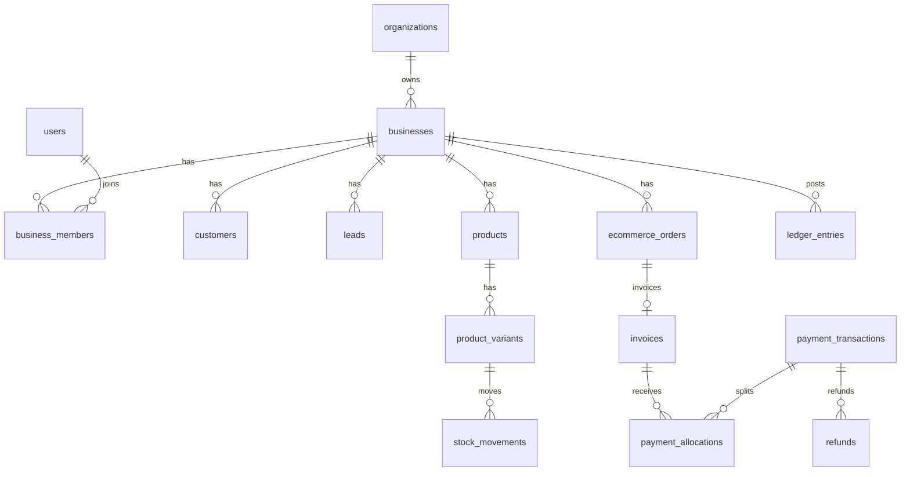

# Aayaam — requirements and API report

This report describes the system that is actually in the repository. It does not treat the demo workspace as a live merchant, and it does not treat an adapter as a connected integration.

Architecture background is in `docs/ARCHITECTURE.md`. Local configuration names are in `.env.example`. No real secrets are stored there.

## What was verified

- `npx vitest run`: 10 tests passed. They cover paise math, tenant isolation, salesperson field hiding, lead deduplication, blocked payment reminders, split tenders, idempotent orders and stock, refunds that do not rewrite the original payment, webhook signature rejection and duplicate delivery, snapshot restore into a second database, currency changes that leave old ledger rows in INR, and refunds that stay unexecuted until approval.
- `npx tsc --noEmit` passed after the last type fix.
- `npx next build` completed. Authenticated API routes are dynamic.
- In the browser, the local demo signed in as `rohan@aayaam.local`, the overview showed Shakti Fitness book figures (₹4,800 receivable, ₹75,000 rent), a new lead was saved from the Sales form and appeared in the pipeline, and switching to Mitti Crafts changed the overview to that business’s posted revenue, reconciliation item, and teak-lamp stock.

The Figma file `XoqqsWCVcSwDx4tk4LcO1N` could not be read. The Figma connection returned “you don’t have edit access” for both session creation and design context. The shell and overview keep the purple dashboard already built for that file. Later module screens use the same tokens and cards, but they were not matched frame-by-frame to Figma.

There is no point-of-sale screen, counter checkout, barcode till, or parked cart.

## A. Product implementation status

| Module | Status | What works | What does not |
|---|---|---|---|
| Identity and tenancy | Complete and tested | Register, scrypt passwords, HTTP-only session, business switch, owner role on create, INR and Asia/Kolkata defaults | Email verification is stored as unverified. Password reset is stored and is not emailed. Invitation acceptance is not built. MFA is not built. |
| Customers | Complete and tested | Create, phone uniqueness, same name allowed when the phone differs, CSV import report with duplicates kept visible | No merge tool for two existing records. |
| Sales | Partially implemented | Lead capture, open-lead phone dedupe, stages, follow-up task from the lead rule | No website form endpoint, CSV lead import, or live WhatsApp capture. |
| Customers communication | Partially implemented | Reminder preview. Blocked while a payment is pending, initiated, app-confirmed, or under investigation. Nothing is sent. | No WhatsApp, email, or SMS delivery. |
| Commerce | Complete and tested for the local order path. Live stores are awaiting credentials | Products, stock movements, idempotent order ingest, invoice only when e-commerce billing is on and the order is paid, PDF download, credit notes | Shopify and WooCommerce are not called. No live catalogue sync. |
| Finance | Complete and tested | Append-only ledger, expenses, opening receivable, revenue shown separately from expenses, reconciliation queue | Not a statutory accounting or GST-filing product. Cost of goods is not a full valuation engine. |
| Payments | Complete and tested | Split allocations, explicit states, bank-settled requires reference and evidence, cash cannot be marked bank-settled, refunds append reversals | No live Razorpay payment creation. Pending UPI is not polled. |
| Operations | Partially implemented | Tasks, one lead follow-up rule, approval queue for a proposed refund | No visual workflow builder, milestones, or escalations. |
| Marketing | Partially implemented | Campaign drafts and manual review notes stored as source `manual` | No Search Console, Google Business Profile, or Meta execution. Rankings are not invented. |
| Business Brain | Partially implemented | Deterministic observations with fact versus hypothesis, evidence ids, audit row. High-impact refund proposal does not execute. | No model call even if a key is present. The note in the run says figures stay on the ledger. No semantic memory or pgvector. |
| Integrations | Implemented, awaiting credentials | Adapter list, HMAC verification for Shopify, WooCommerce, and Razorpay, duplicate event id, queued job, Shopify paid-order processing | Status stays `pending_configuration` until a real handshake exists. Credentials in the environment are still not treated as “connected”. |
| Backup | Complete and tested | Snapshot hash, restore into a second database, row-count check, verify action | Not an automated hosted backup. No attachment blobs. |
| Permissions | Complete and tested | Backend checks. Salesperson workspace omits purchase cost, ledger, and payments. | Not every screen has an automated browser test per role. |
| Billing for non-e-commerce | Not implemented, on purpose | Service businesses can use the ledger | Invoice, credit note, and store order APIs reject them. |

`lib/mock-data.ts` remains in the repo and is not used by the signed-in application.

## B. Required API inventory

An API is “required” only when a feature that is actually called depends on it. Signature checks below were confirmed against current Shopify and Razorpay documentation during this build. Pricing was not copied from vendor pages because it changes by plan and volume. Treat every cost as requiring a provider quotation.

| API / provider | Purpose | Modules | Required capabilities | Authentication | Permissions | Webhooks | Documentation | Approval | Costs | Configuration | Current status | Alternative |
|---|---|---|---|---|---|---|---|---|---|---|---|---|
| Shopify Admin API and HTTPS webhooks | Orders and catalogue for an e-commerce business | Commerce, finance | Read orders and products. Verify `X-Shopify-Hmac-Sha256` as base64 HMAC-SHA256 of the raw body with the app client secret. Dedupe with `X-Shopify-Webhook-Id`. | OAuth for a custom app, or the client secret for webhook HMAC | App scopes must be chosen for the resources actually subscribed. Confirm the current scope list in the Shopify docs before creating the app. | Order topics such as `orders/paid` and `orders/fulfilled`. Confirm the exact topic names in the current webhook reference. | https://shopify.dev/docs/apps/build/webhooks/verify-deliveries and https://shopify.dev/docs/api/webhooks/latest | A public app needs Shopify app review. A custom app on the merchant’s own store may not. Confirm for the chosen distribution. | Shopify plan plus any app charges. Not estimated here. | `SHOPIFY_API_KEY`, `SHOPIFY_API_SECRET`. Server only. | Implemented, awaiting credentials. Adapter does not call Shopify. | Manual order ingest for a test store row. |
| WooCommerce REST API | Same role for WordPress stores | Commerce | REST reads and webhook HMAC. This build verifies base64 HMAC-SHA256 with `WOOCOMMERCE_WEBHOOK_SECRET` and header `X-WC-Webhook-Signature`. Confirm that header against the current WooCommerce webhook guide before production. | Consumer key and secret over HTTPS | Read orders and products on the store key | Order created and order updated | https://woocommerce.github.io/woocommerce-rest-api-docs/ | None beyond the store admin creating the key | Hosting of the store. API itself is part of WooCommerce. | `WOOCOMMERCE_CONSUMER_KEY`, `WOOCOMMERCE_CONSUMER_SECRET`, `WOOCOMMERCE_WEBHOOK_SECRET`. Server only. | Implemented, awaiting credentials. | Manual order ingest. |
| Razorpay Payments API and webhooks | Settlement evidence for UPI, card, and bank collections | Payments, reconciliation | Create or fetch payments only after a merchant account exists. Verify `X-Razorpay-Signature` as hex HMAC-SHA256 of the raw body with the webhook secret. Dedupe with `x-razorpay-event-id`. | Key id and key secret. Webhook secret is separate from the key secret. | Payments and refunds permitted on the merchant account | `payment.captured`, `payment.failed`, `refund.processed`. Confirm the event names in the current Razorpay webhook catalogue. | https://razorpay.com/docs/webhooks/validate-test | Razorpay merchant onboarding and, for some methods, KYC | Transaction fees depend on the method and the merchant agreement. Not estimated here. | `RAZORPAY_KEY_ID`, `RAZORPAY_KEY_SECRET`, `RAZORPAY_WEBHOOK_SECRET`. Server only. | Signature check implemented. No payment is created. A captured webhook is not yet mapped onto `bank_settled`. | Record a pending payment, then mark bank-settled only with a reference and statement evidence. |
| WhatsApp Business Platform, Cloud API | Customer messages after an approved template and a stable balance | Customers | Send a template or session message only after the draft is allowed | System user token | `whatsapp_business_messaging` and phone-number access. Production sending needs Meta business verification and, for many templates, app review. | Message status webhooks if delivery state is stored | https://developers.facebook.com/docs/whatsapp/cloud-api | Yes for production messaging | Conversation-based pricing. Confirm the current rate card. | `WHATSAPP_TOKEN`, `WHATSAPP_PHONE_NUMBER_ID`. Server only. | Not implemented beyond a blocked or draft row. | Copy the draft and send it yourself. |
| Email provider | Password reset, invitations, invoice mail | Identity, customers | Transactional send | API key | Send on a verified domain | Delivery and bounce events if those states are stored | Choose one provider. None is integrated. | Domain authentication (SPF, DKIM) | Depends on the provider | Not allocated | Not implemented | Reset tokens stay in the database and are not returned by the API. |
| SMS provider | Not used | None | None until a business asks for SMS reminders | — | — | — | — | — | Coin-style pricing was a competitor complaint. Do not copy it blindly. | — | Not implemented | WhatsApp or email after those exist. |
| Google Business Profile APIs | Listing and reviews, only after Google approves the project | Marketing | Read location and reviews. Do not invent ratings. | OAuth | The current Google access process must be read on the official setup page. Access has historically required an approved project. | Not subscribed | https://developers.google.com/my-business/content/basic-setup | Yes. Confirm the current application process. | Confirm with Google | `GOOGLE_CLIENT_ID`, `GOOGLE_CLIENT_SECRET`. Server only. | Not implemented. Manual review notes are labeled `manual`. | Enter a note by hand. |
| Google Search Console API | Query and page performance for Local SEO | Marketing | Search analytics for a verified property | OAuth | Confirm the current webmasters scope on the API reference. Do not assume a scope from memory in production. | Not required for a pull report | https://developers.google.com/webmaster-tools/v1/api_reference_index | The property must be verified in Search Console | Included with Google Cloud. Confirm quotas. | Same Google OAuth client. Server only. | Not implemented | No ranking claims. |
| Meta Marketing API | Campaign performance and, later, authorized publishing | Marketing | Read insights. Publishing is a separate, higher-risk permission. | OAuth user or system token | `ads_read` for reports. `ads_management` only if publishing is later approved. | Optional leadgen if lead ads are used | https://developers.facebook.com/docs/marketing-apis | Meta app review for production access | Ad spend is the merchant’s. API access itself needs confirmation. | `META_APP_ID`, `META_APP_SECRET`, `META_ACCESS_TOKEN`. Server only. | Not implemented. Campaigns stay drafts. | Plan the campaign inside Aayaam and publish it in Meta’s own tools. |
| OpenAI, Anthropic, or Gemini | Optional narration of already computed figures | Business Brain | A text response that cannot change totals | API key | Account billing access | None | https://platform.openai.com/docs , https://docs.anthropic.com , https://ai.google.dev/gemini-api/docs | Provider account | Usage-priced. Not estimated. | `OPENAI_API_KEY` or `ANTHROPIC_API_KEY` or `GEMINI_API_KEY`. Server only. | Not called. A present key does not switch the brain off the ledger. | Deterministic observations. |
| Supabase Postgres | Production database, auth option, storage, RLS | All records | The schema in `server/db/schema.sql` plus the policies in `db/postgres/002_rls.sql` | Project keys on the server. The anon key must not be able to read tenant tables. | Service role stays on the server | None from Supabase for business events | https://supabase.com/docs | A Supabase project | Depends on size, egress, and auth volume. Not estimated. | `DATABASE_URL` is reserved and unused. | Not connected. Local SQLite is the running database. | `data/aayaam.sqlite` |
| Bank or account-aggregator feed | Automatic settlement matching | Reconciliation | Statement lines with amount, reference, and date | Provider-specific. Account aggregator participation in India has its own registration. | Read transactions for the linked account | Provider events | Confirm the chosen provider’s current official docs. None is integrated. | Often yes | Provider quotation | None | Not implemented | A person marks bank-settled with a reference and `settlementEvidence`. |
| Background host such as Inngest | Durable retries if the web process is not the worker | Webhooks | Run `processQueuedJobs` | Provider key | — | — | https://www.inngest.com/docs | Account | Usage-priced | Not allocated | Not implemented. Jobs are rows processed in the web process. | Call `jobs.process` from an operations screen or a future worker. |
| Error monitoring | Production exceptions | Operations | Capture server errors without request bodies that contain secrets | DSN | — | — | Choose Sentry or an equivalent | Account | Usage-priced | Not allocated | Server errors return a generic message and are logged with `console.error`. | Host logs |

WooCommerce’s webhook signature header was not re-read from WooCommerce’s site in this session. The implementation and the table above must be checked against the current WooCommerce webhook document before a store is connected.

## C. Categories that were evaluated and are not required yet

- SMS is not required. No feature sends SMS.
- A second payment provider is not required. Razorpay is the only payment API named, and even that is not called.
- Google Drive backup is not required. Snapshots are rows in the business database.
- n8n is not required. The lead follow-up rule is internal.
- pgvector is not required. Retrieval is SQL over the tenant’s own rows.

## D. Environment variables

`.env.example` lists every name the code reads. All of them are server runtime values. None are `NEXT_PUBLIC_` variables. Blank values are optional and keep the related feature in a pending or deterministic state.

| Variable | Required? | Who supplies it | Where |
|---|---|---|---|
| `AAYAAM_DEMO_PASSWORD` | Optional. Local demo only. | You, for a development database | Server |
| `AAYAAM_SEED_DEMO` | Optional. Set to `1` only to seed a production process. | You | Server |
| `SHOPIFY_API_KEY`, `SHOPIFY_API_SECRET` | Required only to verify Shopify webhooks | Shopify app | Server |
| `WOOCOMMERCE_CONSUMER_KEY`, `WOOCOMMERCE_CONSUMER_SECRET`, `WOOCOMMERCE_WEBHOOK_SECRET` | Required only for a WooCommerce store | Store admin | Server |
| `RAZORPAY_KEY_ID`, `RAZORPAY_KEY_SECRET`, `RAZORPAY_WEBHOOK_SECRET` | Required only for Razorpay | Razorpay dashboard | Server |
| `WHATSAPP_TOKEN`, `WHATSAPP_PHONE_NUMBER_ID` | Required only if sending is later built | Meta | Server |
| `GOOGLE_CLIENT_ID`, `GOOGLE_CLIENT_SECRET` | Required only for a future Google connection | Google Cloud | Server |
| `META_APP_ID`, `META_APP_SECRET`, `META_ACCESS_TOKEN` | Required only for a future Meta connection | Meta | Server |
| `OPENAI_API_KEY`, `ANTHROPIC_API_KEY`, `GEMINI_API_KEY` | Optional. Unused for numbers. | The chosen model vendor | Server |
| `DATABASE_URL` | Unused today. Reserved for Postgres. | Supabase or another Postgres host | Server |

## E. Database report

The running schema is `server/db/schema.sql` on SQLite. Foreign keys and WAL mode are on. Money is an integer number of paise. Quantities are milli-units. Ledger rows have no update or delete path in the application. A correction is a new row with `reversal_of` set.

Tenant isolation in SQLite is the actor check: a service loads a row and rejects it when `business_id` does not match the session. Tests cover a cross-business customer edit. PostgreSQL row-level security is written in `db/postgres/002_rls.sql` and has not been applied to a database. SQLite cannot enforce those policies.

Important uniqueness rules: active customer phone per business, open lead phone per business, product SKU, external order id per store, payment idempotency key, provider reference, webhook event id, and stock movement source.

Financial writes for a payment, invoice, refund, credit note, and expense run in one SQLite transaction. A retry of the same external order does not create a second invoice or a second sale movement.

Changing `businesses.currency` updates the default only. The currency test asserts every existing ledger row stays INR.

Backup: `backup.create` stores a JSON snapshot and its SHA-256. `backup.verify` restores that snapshot into a temporary database and compares row counts. That is a tested restore of the snapshot, not a restore onto the live file. There is no off-site backup schedule.

## F. Security report

- Passwords are scrypt hashes. The session cookie is HTTP-only and `SameSite=Lax`. `Secure` is added when `NODE_ENV` is production.
- Mutations check the `Origin` host against the request host.
- Login attempts are limited to 8 per email per 10 minutes in process memory. A restart clears the counter. This is not a distributed limit.
- Authorization is the role matrix in `server/permissions.ts`, enforced in services. Sensitive fields are removed in `buildWorkspace` before the response.
- Webhook signatures that fail are stored under a different id so a later valid delivery of the same event id can still be accepted. Invalid signatures return 401.
- Razorpay’s published guidance also says to return 200 quickly, ignore stale events, and process after the response. This build validates and stores the event before responding. It does not yet reject events older than five minutes, and it does not map a captured Razorpay payment onto `bank_settled`.
- Audit rows are appended for creates, payments, stock, backups, and brain runs.
- Errors returned to the browser use a code and a message. Unexpected errors are logged and replaced with “Something went wrong”.
- Known risks: SQLite has no RLS, so a missed `business_id` check would leak data. The local demo password is documented and must not be used on a shared server. Invitation tokens are hashed, but there is no accept endpoint. Reset tokens are not emailed and are not returned by the API. The in-process rate limit and job queue die with the process. PDF invoices are a plain text page, not a signed tax document.

Recommended tests still to add: browser tests for a salesperson session, a concurrent double-submit of the same idempotency key, and a Razorpay event older than the provider’s replay window.

## G. Infrastructure and cost

| Piece | Current choice | Cost |
|---|---|---|
| Application | Next.js on one Node process | Hosting quotation required |
| Database | Local SQLite file `data/aayaam.sqlite` | Disk only |
| Production database | Not provisioned. Postgres SQL policies are prepared. | Supabase or another Postgres bill, unknown until size is known |
| Workers | Rows in `sync_jobs`, processed in the web process | No extra vendor |
| Files | Invoice PDF is generated in memory. No object storage. | None |
| AI | Not called | Zero until a key is used |
| Messaging | Not called | Zero |
| Monitoring | Process logs | Zero |

Costs that cannot be estimated here: Shopify app charges, Razorpay MDR, WhatsApp conversation fees, Meta ad spend, Google API quotas, Supabase compute, and an error-monitoring plan.

## H. Outstanding requirements

The owner still needs to decide or supply:

1. A hosting target and whether production data lives in Supabase.
2. Shopify and WooCommerce app credentials, and which store is first.
3. A Razorpay merchant account and webhook secret, plus the decision to map `payment.captured` to `bank_settled`.
4. Whether WhatsApp, email, or both will send reminders. Domain and template approval.
5. Whether Google Business Profile and Search Console access will be applied for. Google’s current approval rules need to be read before promising reviews or rankings.
6. A GST configuration review by someone qualified to say whether the configured tax rate is the rate that business should charge. The software does not file returns.
7. Whether the demo businesses should be deleted before any real merchant is invited.
8. A subscription and plan model. The schema does not bill anyone.
9. A production security review, including moving rate limits and jobs out of process memory.
10. Figma edit access if the remaining screens must match unpublished frames.

## I. Recommended next steps

1. Use the local app now: sign in with the demo user, switch between Shakti Fitness, Mitti Crafts, and Studio Aangan, and record only data you are willing to keep in `data/aayaam.sqlite`.
2. Change `AAYAAM_DEMO_PASSWORD` before anyone else can reach the machine. Do not set `AAYAAM_SEED_DEMO=1` on a shared server.
3. Have an accountant confirm invoice tax fields before a real e-commerce invoice is sent to a customer.
4. Create the Shopify or WooCommerce app and Razorpay webhook only after the signature and replay gaps in section F are accepted or closed.
5. Add an email provider before inviting staff. Until then, invitations are stored and not delivered.
6. Apply `db/postgres/002_rls.sql` on a staging Postgres project and rerun the tenant test there before calling the database production-ready.
7. Keep Business Brain on the deterministic path until the ledger queries are the ones a merchant trusts. A model key must not become a source of totals.
